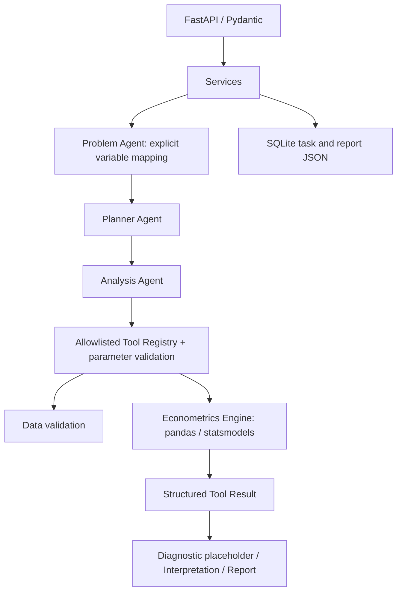

# Architecture

当前范围为 Phase 0 + 基础 Phase 1。采用普通 Python 函数组成同步流水线，无外部 LLM。

## 边界

- API：请求验证、HTTP 状态码、响应 schema，不包含计量计算。
- Agent：解释显式变量映射、生成计划、调用白名单工具、整理计算结果。
- Engine：可独立调用和测试，完全不依赖 Agent、数据库或 LLM。
- Data：当前仅验证内联数值表；不自动清洗或改变样本。
- SQLite：保存每一步状态和最终报告，使用参数化 SQL，每次操作关闭连接。

## 执行约定

POST /agent/research 同步执行并返回最终 TaskState。状态依次为 created、planning、running、completed；失败为 failed。每一步执行前保存 current_step，执行后保存 ToolResult；已完成报告和状态在同一次 SQL 更新中保存。研究执行失败仍返回 HTTP 200 的 failed 状态，调用方必须检查 status；请求 schema 错误返回 422。

GET /agent/task/{task_id} 读取持久化状态；GET /report/{task_id} 对不存在任务返回 404，对无报告任务返回 409。异常输出统一为 `{ "error": { "code": "...", "message": "..." } }`。

规则式 Problem Agent 目前依赖 dependent_variable 和 independent_variables，不声称可以理解任意自然语言。诊断阶段只标记 not_implemented，不产生虚假统计结果。

## 当前限制

同步执行适合小型本地研究；没有任务队列、取消或进程崩溃恢复。进程异常退出时 running 状态可能保留，后续加入持久化 worker 时再实现恢复策略。当前未保存原始完整数据和计划参数，仅保存摘要、步骤和计算结果；可复现数据快照及变换溯源属于 Phase 3。服务仅供本地开发，没有鉴权、多用户隔离或上传处理能力。

## 扩展方式

实现 Engine 函数 → 增加输入/结果 schema → 注册工具 → 数值测试 → 调整 Planner → API 测试。未来 LLM 只生成经 schema 验证的计划和解释，不运行任意 Python、不修改计算结果。
